# Results

All numbers were read from runs of this app on a Google Colab T4 GPU. Raw exports are in this folder: `metrics.csv`,
`experiment_config.json`, `reproducibility_report.json`, `evaluation_report.pdf` and the training-curve images
(`*_curves.png`). Screenshots are in `figures/`.

## Dataset (Task 4)
Synthetic shapes dataset: 600 images, 3 classes (circle, square, triangle), 200 per class, varied captions (3 to 12 words).
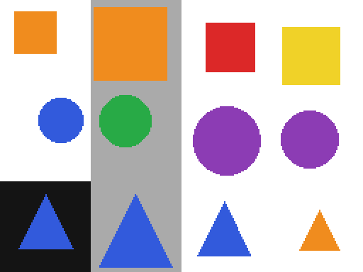

Dataset Explorer on `shapes_dataset`: Overview (600 images, 3 classes, 64 x 64, 0 corrupted files, 0 duplicates, 0.2 MB), class
distribution (200 per class, all PNG), image-size statistics (every image 64 x 64), the sample viewer, and the Descriptions tab
(600 captions, 246 unique, 7.35 words per caption on average, 3 to 12 words, 39.4 characters).

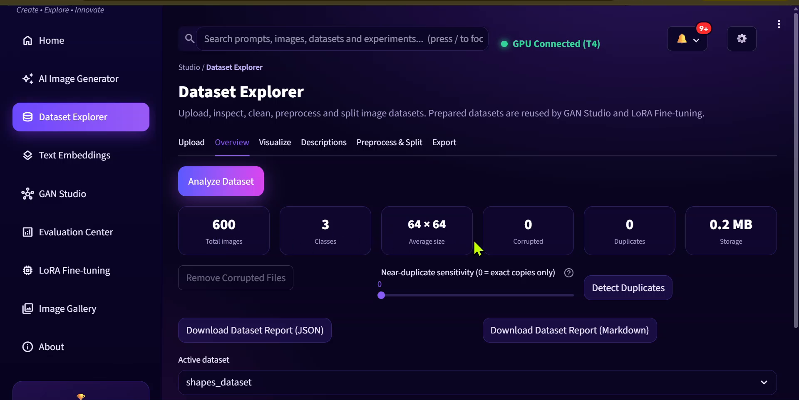
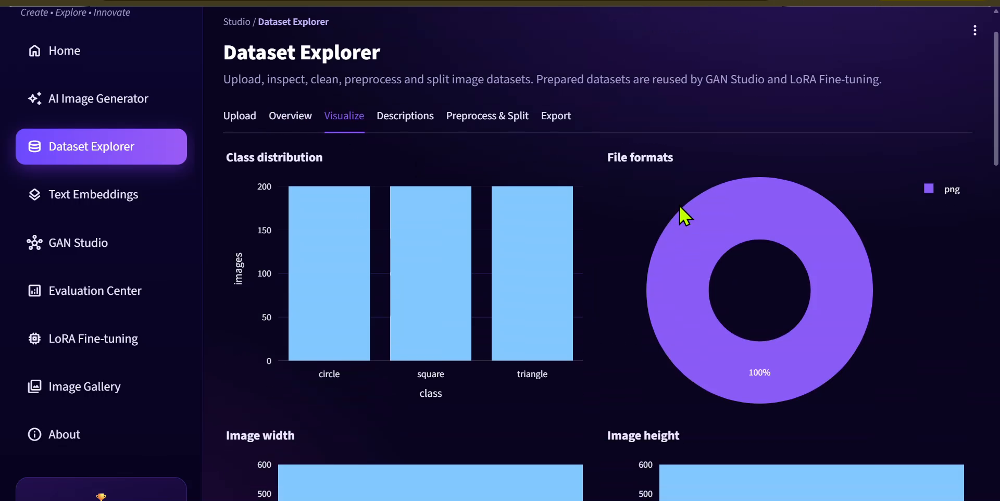
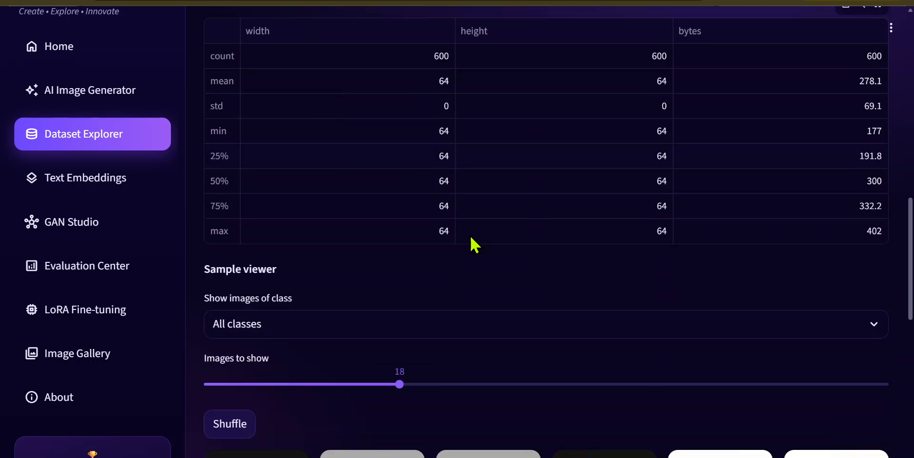
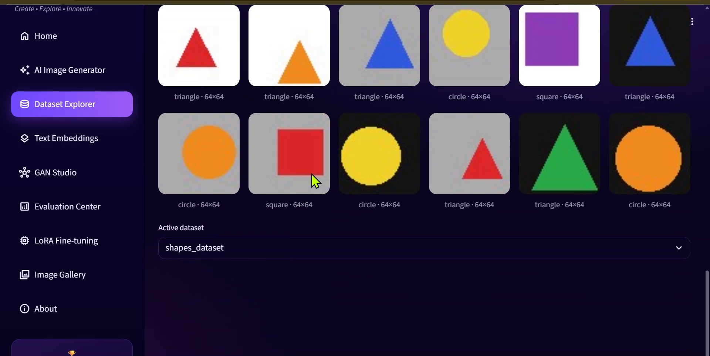
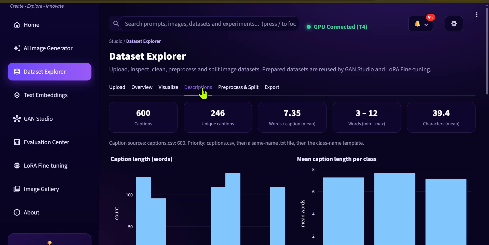

Oxford-102 has only templated captions ("a photo of a ..."), so its description-length statistics are constant. The shapes set has
varied captions, which is why the caption analysis is shown on it. The COCO importer in `tools/import_coco_subset.py` is provided
and unit-tested, but it was not run for these results.

## Text embeddings (Task 3): CLIP ViT-B/32 text encoder, 512-d
| Check | Result |
|---|---|
| Tokens for the 5 test prompts | 10, 9, 8, 9, 11 (including start / end tokens) |
| Embedding shape / mean pairwise similarity | [5, 512] / 0.483 |
| Two dog prompts / two city prompts | 0.66 / 0.82 cosine similarity |
| Wording test ("A golden retriever playing in a garden" vs "A happy dog playing outside in a yard") | 0.6938 |
| CLIP (512-d) vs Sentence-Transformers all-MiniLM-L6-v2 (384-d) | rank agreement (Spearman) 0.564 |

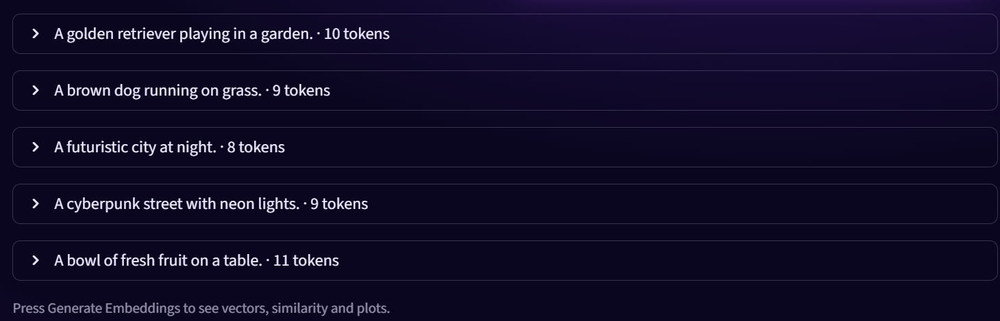 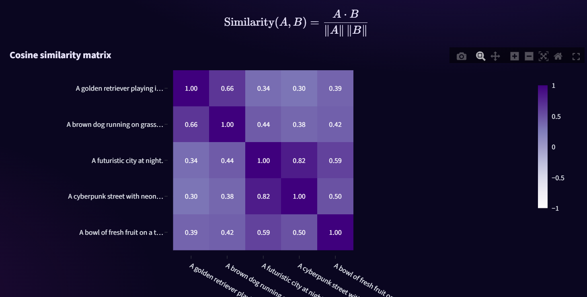 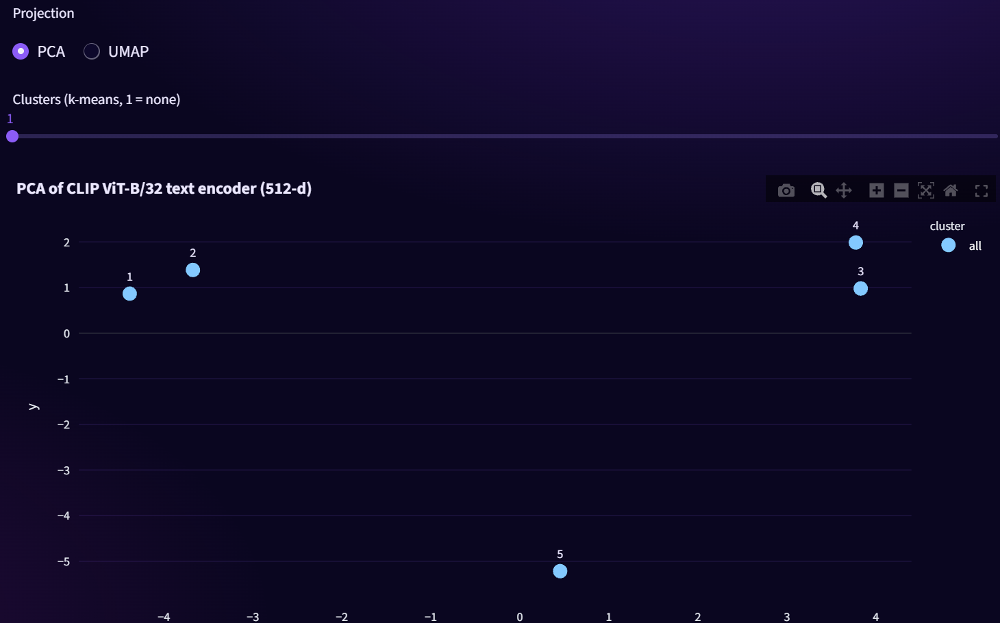
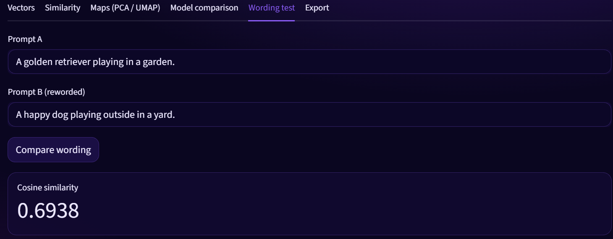 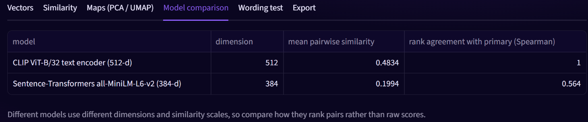

The Vectors tab shows the 512-number embedding of each prompt:

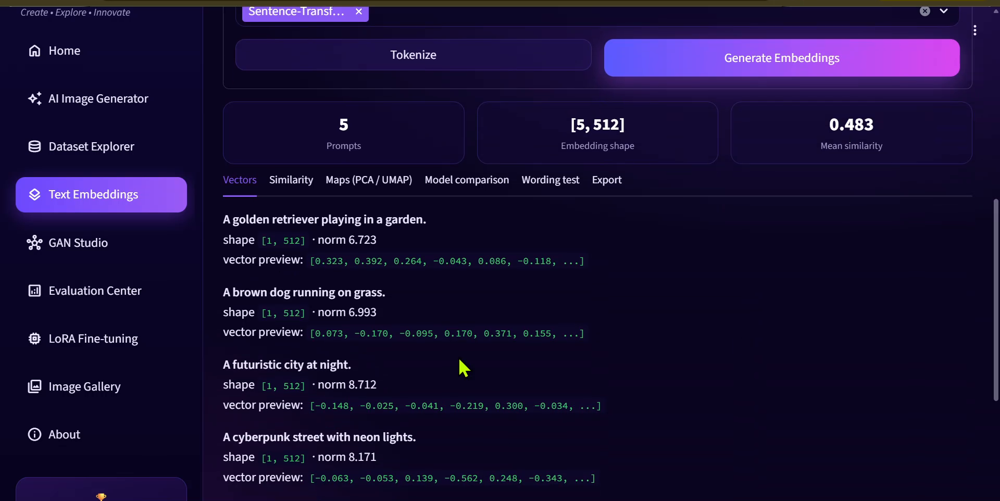

## GAN evaluation (Tasks 2 and 5): `metrics.csv`, experiments 1 to 5
Dataset `shapes_dataset`, class-label conditioning, 200 epochs, 32 px. Reference classifier (8 epochs, 32 px): 97.8% accuracy
and macro AUC 1.0 on real held-out images. Generated images: 50 per class (150 per run), seed 0.

| Model (run) | Accuracy | Macro AUC | FID | Generated images used for FID |
|---|---|---|---|---|
| CGAN (`cgan_1125_1304`) | 66.7% | 0.833 | 327.74 | 144 (600 real) |
| Attention CGAN (`attn_1125_1314`) | 100% | 1.000 | 306.92 | 192 (600 real) |

Reading these numbers:
* The label-conditioned runs produce one picture per class (the samples of a class are identical), so accuracy moves in steps of one
  class: 66.7% means 2 of 3 classes were recognised, 100% means 3 of 3. AUC is equally coarse.
* The label clearly controls the shape. The Attention CGAN scores better on both measures, but with this little variety it is not
  strong evidence that attention improves image quality.
* The FIDs are above 300 (far from the real images), used different numbers of generated images, and are below 2048 images per set,
  so `reliable` is False in `metrics.csv`. Compare them with each other only roughly, never with published values.

Training curves: `cgan_1125_1304_curves.png`, `attn_1125_1314_curves.png`, `cgan_1125_1351_curves.png`, `attn_1125_1355_curves.png`.

Label-conditioned samples from the CGAN (4 per class): each class gives its own shape, but the four samples of a class are identical.

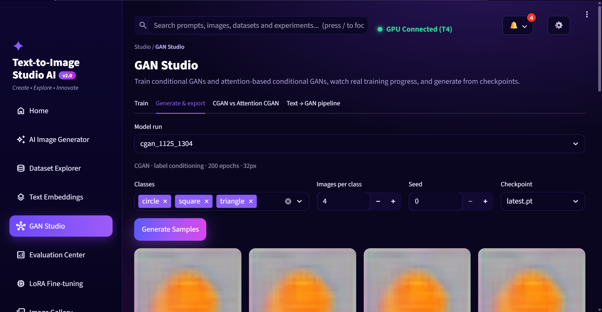
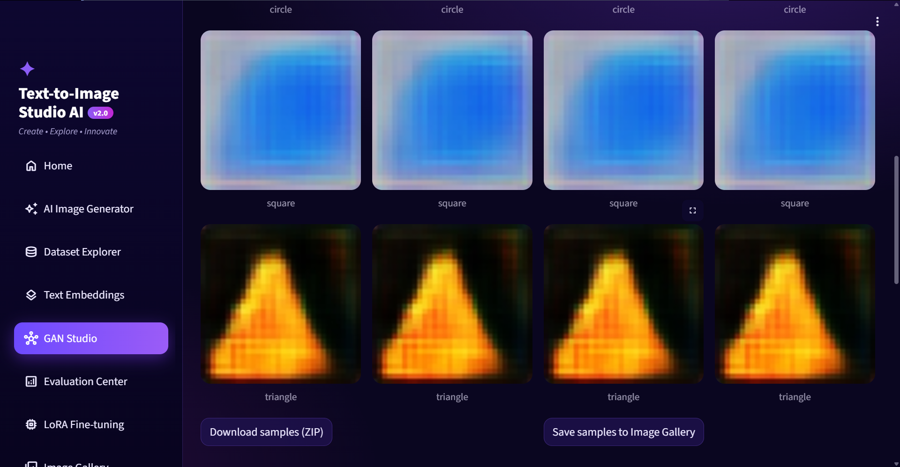

Classifier evaluation and FID screenshots:

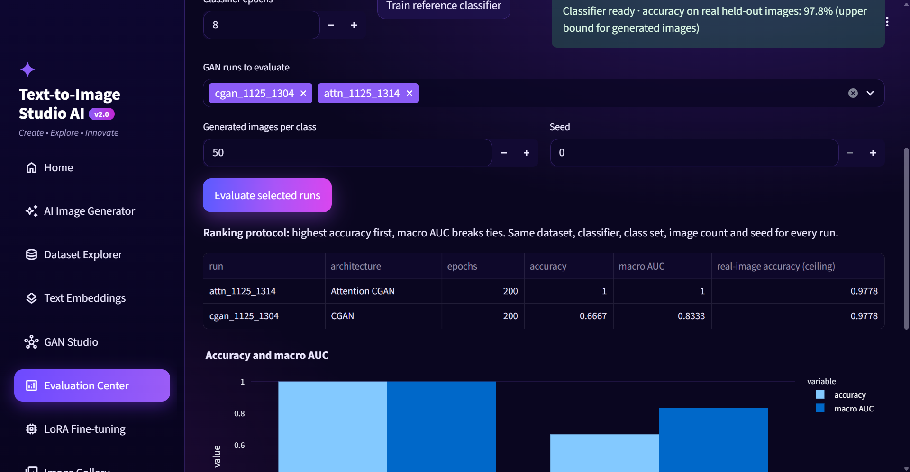
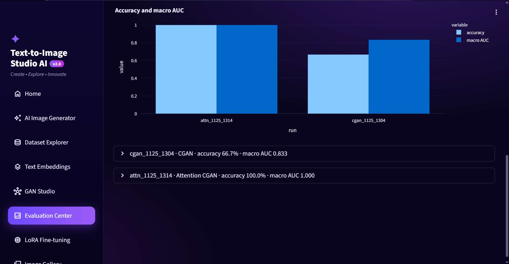
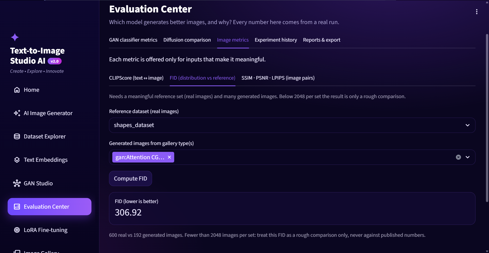
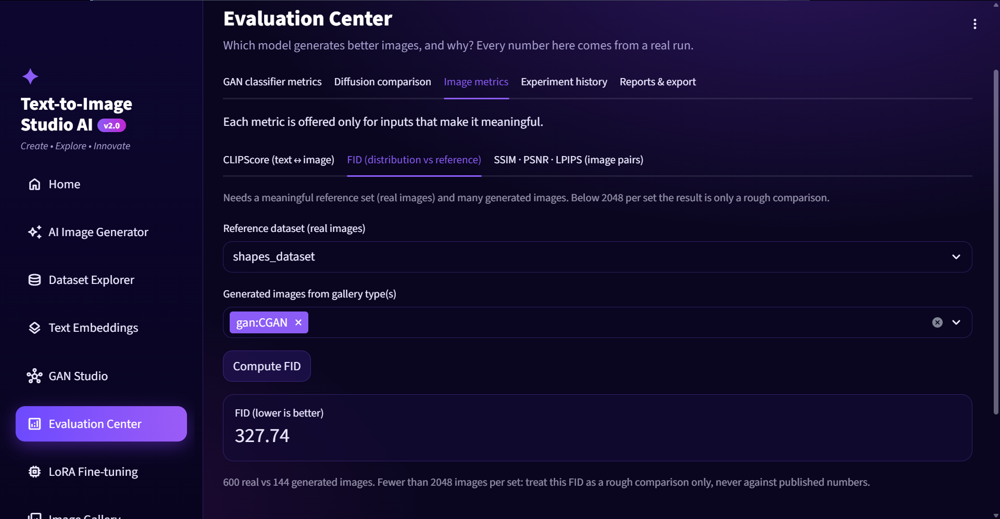

## Text -> GAN pipeline (Task 6)
Attention CGAN trained with CLIP text conditioning (`attn_1125_1355`). The prompts "a photo of a circle", "a photo of a triangle"
and "a photo of a square" were tokenized, encoded to a `[1, 512]` CLIP embedding, matched to the nearest training caption
(circle, triangle and square respectively; cosine 0.97 for "triangle") and drawn by the generator. The four samples per prompt
differ in colour, size and position. The images are small and blurry.

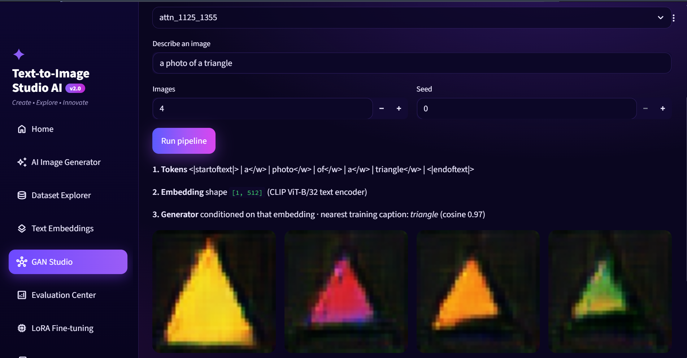
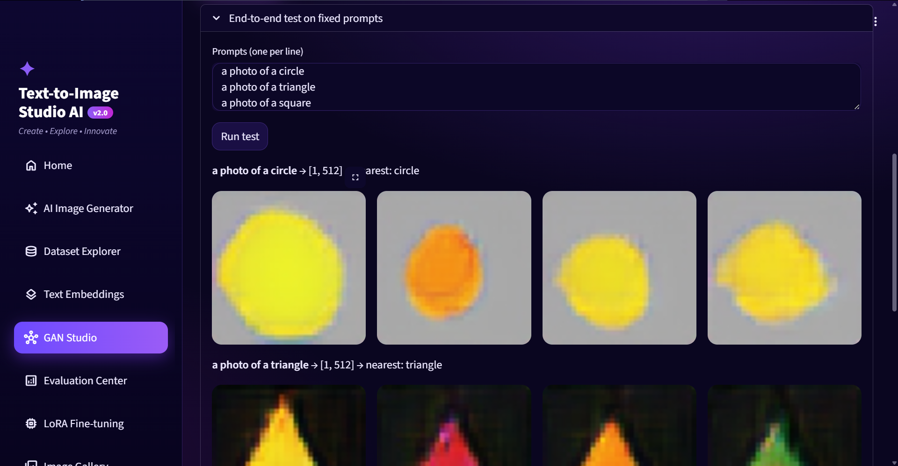
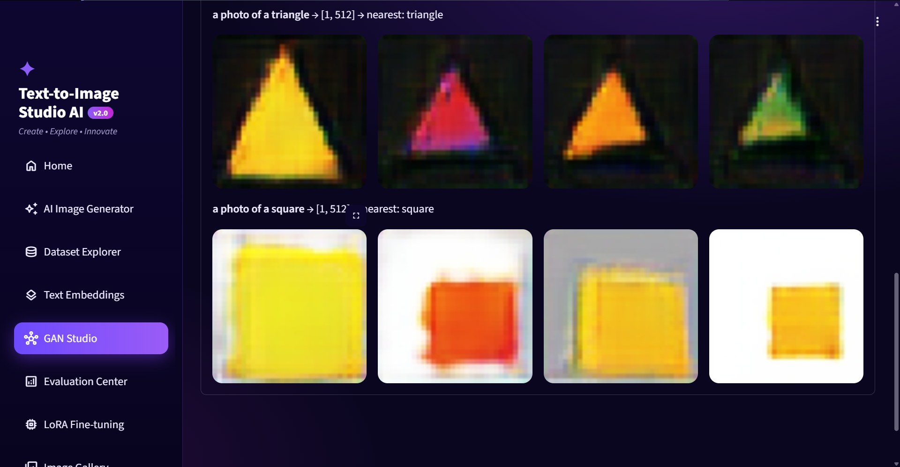

## LoRA fine-tuning (Task 1): `metrics.csv`, experiments 6 to 10
Stable Diffusion 1.5, adapter `my_style`, 24 captioned images, rank 8, alpha 16, learning rate 0.0001, 30 epochs, batch size 1,
gradient accumulation 4, resolution 512, seed 42 (about 510 s, 1.59 M trainable parameters). The before / after tab generated the
base model and the adapter with the same prompt and seed.

| Experiment | Prompt | CLIPScore base | CLIPScore with adapter |
|---|---|---|---|
| 10 | "A portrait of a cat, detailed" | 31.95 | 31.80 |
| 9 | same | 31.96 | 32.16 |
| 8 | same | 31.82 | 31.83 |
| 7 | same | 31.90 | 31.87 |
| 6 | "A photo of a lion standing on the top of the mountain ..." | 30.66 | 30.54 |

The adapter changes the generated images (clothing, face markings, ears), but CLIPScore, which measures how well an image matches
its prompt and not its style, does not change by more than about 0.2 points. So these runs show that the adapter is loaded and
alters the output, not that it improves prompt alignment. A prompt from the training domain with the trigger phrase shows the
style effect best.

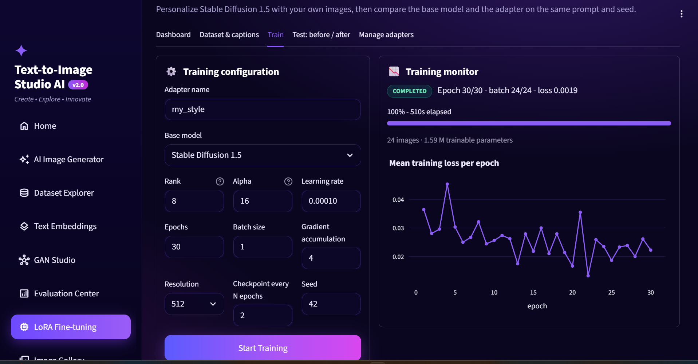
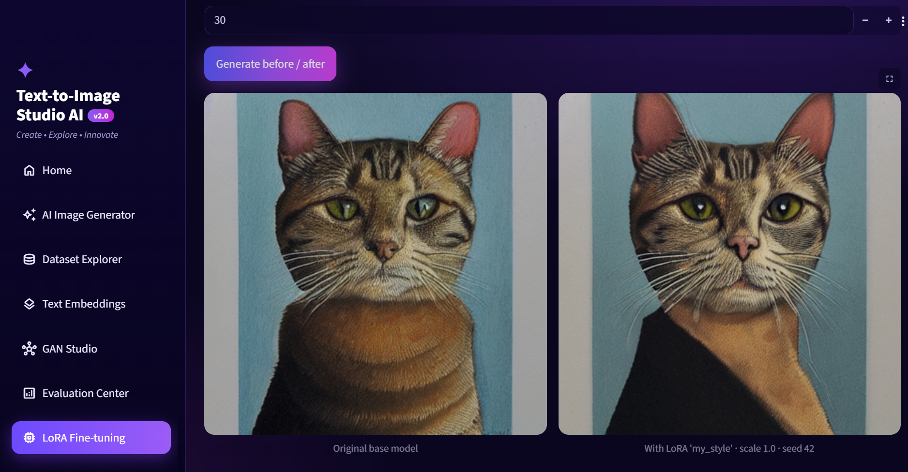
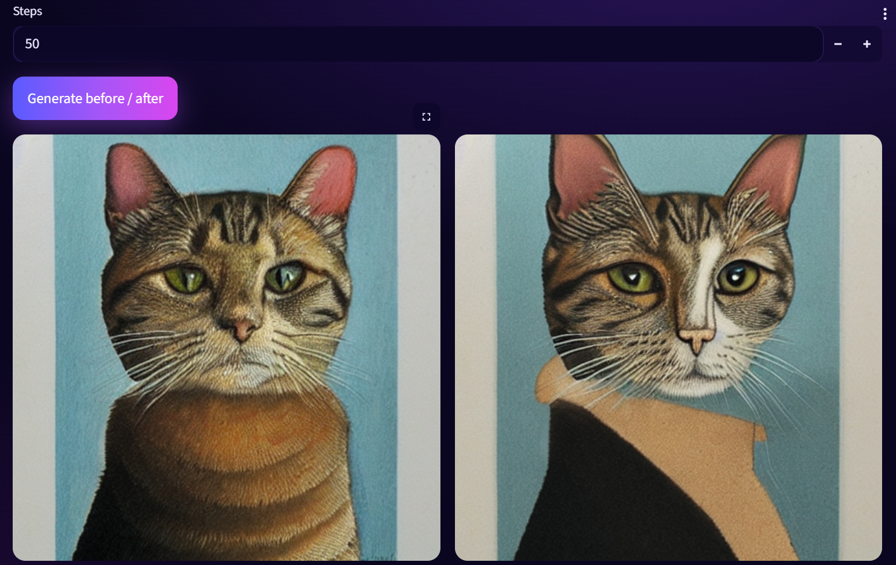
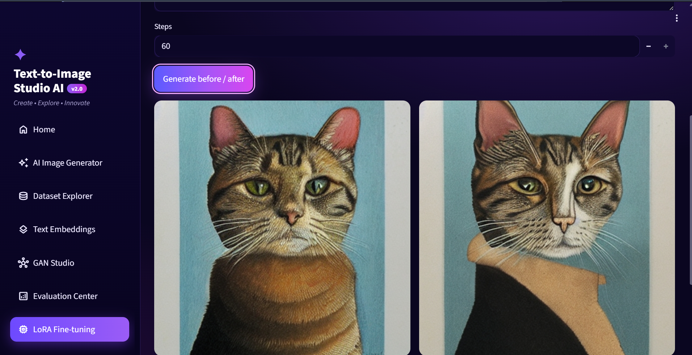

## Exported reports
Evaluation Center -> Reports & export, with every experiment selected. It produced `evaluation_report.pdf`, `metrics.csv`,
`experiment_config.json`, `reproducibility_report.json` and the training-curve images in this folder.

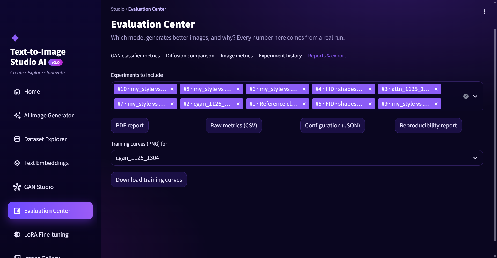

## Earlier runs (not the ones evaluated above)
Two earlier label-conditioned runs, 300 epochs at 64 px with BCE loss, both completed (CGAN: final generator loss 4.496,
discriminator loss 0.438, 869 s; Attention CGAN: 4.647, 0.441, 900 s). The first 20-epoch CGAN run collapsed to identical blobs
(FID 324.10 against 600 real vs 244 generated images).

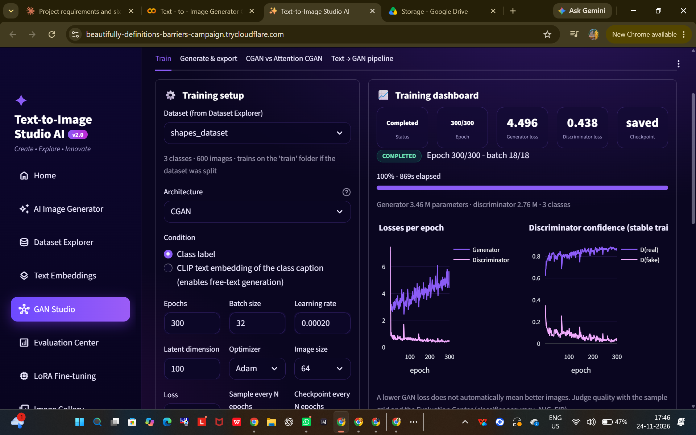 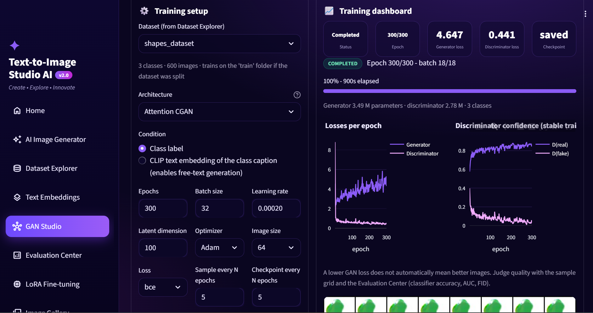
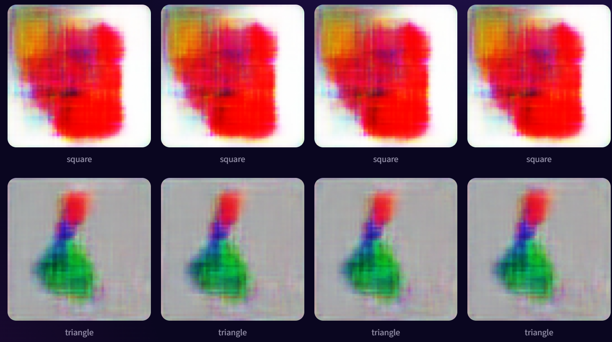
